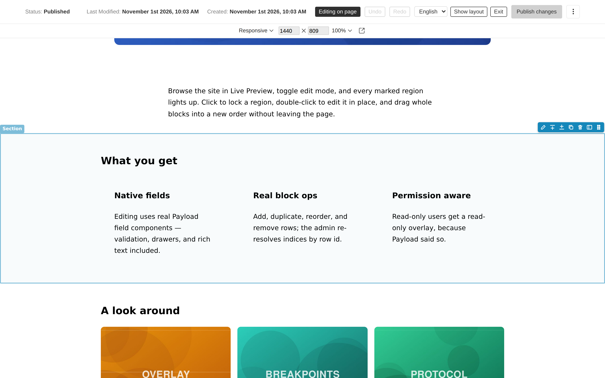
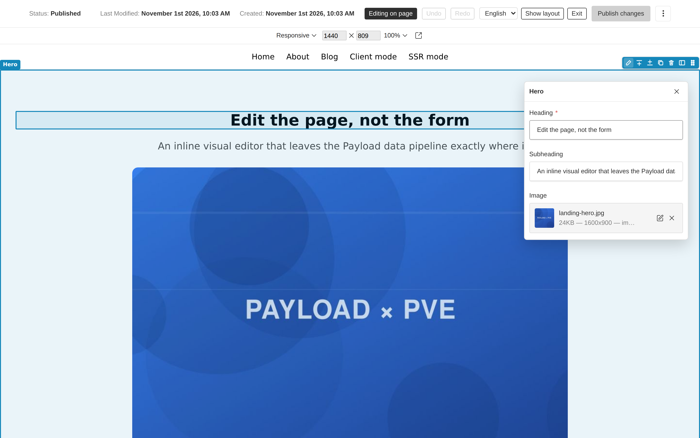
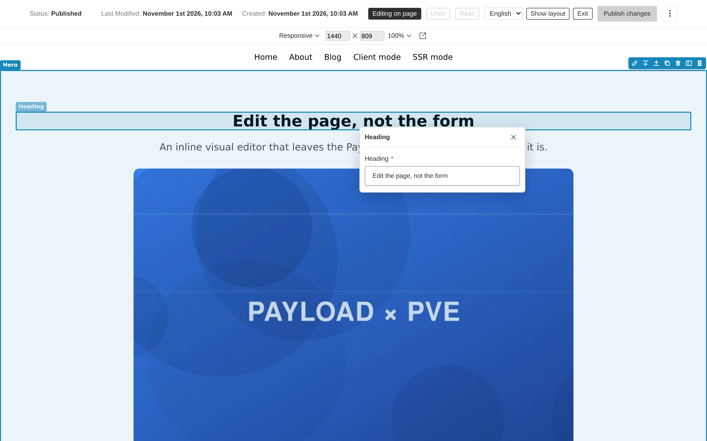
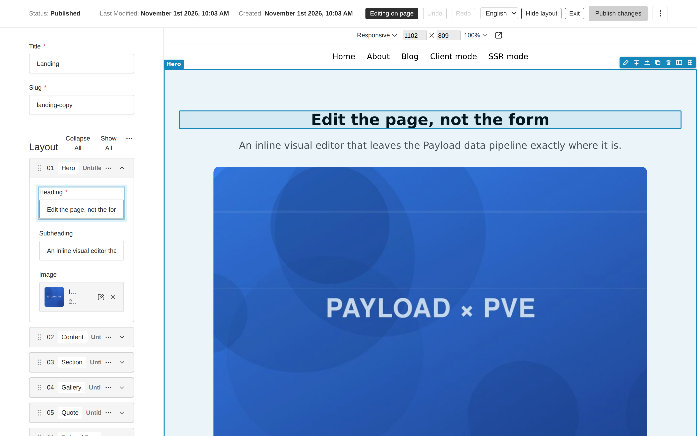
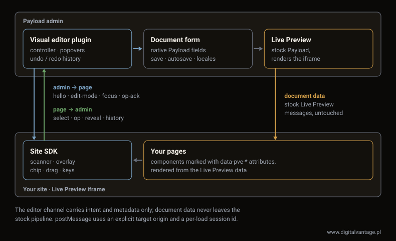

# @digitalvantage/payload-visual-editor

[](https://www.npmjs.com/package/@digitalvantage/payload-visual-editor)
[](./LICENSE)

Inline visual editing for [Payload CMS](https://payloadcms.com) 3.x — browse your site in Live Preview, toggle edit mode, hover-highlight editable regions, double-click to edit any field with native Payload field UI, and add / duplicate / remove / reorder blocks directly on the page, with undo, keyboard control and a translated UI. A dedicated full-screen editor view, cross-document editing drawers, and a toolbar with save / publish / locale round it out.


The editor is layered on top of core Live Preview: the standard save / publish / autosave / versions / locales flow keeps working unchanged, document data flows through the stock Live Preview pipeline, and every field type (Lexical, uploads, relationships, custom plugin fields) gets native editing for free.

> **Status: 1.x.** The public API is stable; changes follow semver. Built and maintained by [Digital Vantage](https://www.digitalvantage.pl/go/pve-github), used on our own production sites first.

## A look around

|  |  |
|---|---|
| **Hover to find a block.** Every marked region outlines on hover, labelled with its block name, with row chips for edit · add above / below · duplicate · remove · reorder · show in layout.<br><br> | **Double-click a block to edit it.** The popover renders the block's own subfields — including uploads and rich text — bound to the same document form the sidebar uses.<br><br> |
| **Or edit a single field.** Double-click any individual marked field to get just that one, anchored next to what you clicked.<br><br> | **The full form is still there.** Toggle the layout panel for the stock Payload blocks UI beside the page — the two stay in sync, and "show in layout" jumps from a block to its row.<br><br> |

## Packages

| Package | Description |
|---|---|
| [`@digitalvantage/payload-visual-editor`](https://www.npmjs.com/package/@digitalvantage/payload-visual-editor) | The Payload plugin (admin side) |
| [`@digitalvantage/payload-visual-editor-core`](https://www.npmjs.com/package/@digitalvantage/payload-visual-editor-core) | Framework-agnostic site SDK (vanilla TS, zero runtime deps) |
| [`@digitalvantage/payload-visual-editor-react`](https://www.npmjs.com/package/@digitalvantage/payload-visual-editor-react) | React/Next adapter: `<VisualEditing/>`, `payloadEditable()` |

## Requirements

- `payload@^3.85` (and `@payloadcms/ui@^3.85`)
- React 19 (the version Payload 3.x uses)
- A Next.js version your Payload release supports. The plugin's `next` peer range mirrors `payload@3.85` (`>=15.2.9 <15.3`, `>=15.3.9 <15.4`, `>=15.4.11 <15.5`, `>=16.2.6`); newer Payload releases may narrow it further, and their range wins
- A working [Live Preview](https://payloadcms.com/docs/live-preview/overview) setup for the collections/globals you want to edit

## Installation

```sh
pnpm add @digitalvantage/payload-visual-editor @digitalvantage/payload-visual-editor-react
```

### 1. Add the plugin

```ts
// payload.config.ts
import { visualEditor } from '@digitalvantage/payload-visual-editor'

export default buildConfig({
  // ...
  plugins: [visualEditor()],
})
```

By default the editor enables itself for every collection and global that has a Live Preview URL (`admin.livePreview.url`, or a root `admin.livePreview` entry listing the slug). You can also enable entities explicitly — see [Plugin options](#plugin-options).

Then regenerate your import map so the admin controller component resolves:

```sh
payload generate:importmap
```

### 2. Mark up your frontend

The editor maps DOM to document data through explicit `data-pve-*` attributes. Paths are form-state data paths relative to the document root, e.g. `layout.0.heading`.

```tsx
import { payloadEditable } from '@digitalvantage/payload-visual-editor-react'

<main {...payloadEditable.scope({ collection: 'pages', id: page.id })}>
  <div {...payloadEditable.container('layout')}>
    {page.layout?.map((block, i) => (
      <section
        key={block.id}
        {...payloadEditable(`layout.${i}`, { row: { id: block.id, blockType: block.blockType } })}
      >
        <h1 {...payloadEditable(`layout.${i}.heading`)}>{block.heading}</h1>
      </section>
    ))}
  </div>
</main>
```

- `payloadEditable.scope(...)` marks the document a subtree belongs to — put it on the outermost element rendering that document. Globals: `payloadEditable.scope({ global: 'header' })`.
- `payloadEditable(path)` marks an editable leaf field.
- `payloadEditable(path, { row })` marks an array/blocks row wrapper. **Pass the row `id` Payload stores on every row** — block operations key off it. `id`/`blockType` accept the nullable types Payload generates, so `row: { id: block.id, blockType: block.blockType }` works as-is. If an id is missing at runtime the row degrades to a plain field and a dev-mode warning fires.
- `payloadEditable.container(path)` marks an array/blocks container — it bounds the drop zone and hosts the empty-state "add" affordance.

The helpers return plain `Record<string, string>` props, so they are RSC/SSR-safe — no client component needed for markup.

### 3. Mount the SDK

```tsx
import { VisualEditing } from '@digitalvantage/payload-visual-editor-react'

// In the page (or layout) that Live Preview loads:
<VisualEditing serverURL={process.env.NEXT_PUBLIC_SERVER_URL!} />
```

`serverURL` is your Payload server's origin — the SDK only accepts messages from it. The component renders nothing, only activates inside an iframe, and stays fully inert until it receives a valid handshake from the admin panel.

### 4. Edit

Open a document in the admin panel, enter Live Preview, and click **Edit on page**. Hover highlights editable regions; a click selects a region, and a double-click expands, scrolls to, and focuses the corresponding form field in the admin panel. Rows show a chip with edit / add / duplicate / remove / show-in-layout / drag-to-reorder. **Undo** / **Redo** next to the toggle revert block changes made on the page (not edits typed into fields).

Keyboard, while edit mode is on and focus is not in one of the page's own form controls:

| Key | Action |
|---|---|
| <kbd>↓</kbd> / <kbd>↑</kbd> | Select the next / previous editable region (rows and fields, in page order) |
| <kbd>Enter</kbd> | Edit the selected region, like a double-click |
| <kbd>Alt</kbd>+<kbd>↓</kbd> / <kbd>Alt</kbd>+<kbd>↑</kbd> | Move the selected row down / up (keyboard alternative to drag) |
| <kbd>Esc</kbd> | Clear the selection |
| <kbd>Ctrl</kbd>/<kbd>⌘</kbd>+<kbd>Z</kbd>, <kbd>Ctrl</kbd>/<kbd>⌘</kbd>+<kbd>Shift</kbd>+<kbd>Z</kbd> or <kbd>Ctrl</kbd>+<kbd>Y</kbd> | Undo / redo block changes — on the page and in the admin (outside text fields) |

## Choosing a preview mode

Both stock Live Preview modes work; they differ in how fast block operations reflect on the page:

| Mode | Setup | Behavior after an op |
|---|---|---|
| **Client mode** (recommended for editing) | [`useLivePreview`](https://payloadcms.com/docs/live-preview/client) | New data streams to the page immediately (~100 ms re-render) |
| **SSR mode** | [`RefreshRouteOnSave`](https://payloadcms.com/docs/live-preview/server) | Change lands after autosave + `router.refresh()` (1–3 s); the editor shows a pending shimmer on the affected container until the page catches up. Block ops in this mode require drafts + autosave |

The [dev playground](./dev) exercises both: [`dev/app/(frontend)/client-mode`](./dev/app/(frontend)/client-mode/%5Bslug%5D/page.client.tsx) and [`dev/app/(frontend)/ssr-mode`](./dev/app/(frontend)/ssr-mode/%5Bslug%5D/page.tsx).

## Dedicated editor view

Besides the "Edit on page" toggle inside the document edit view, the plugin registers a full-screen editor at `/admin/visual-editor/:collectionSlug/:id` (globals: `/admin/visual-editor/globals/:globalSlug`) — a bare view with no admin navigation: a top toolbar (document status, save / publish, locale switcher, exit) and the live preview filling the rest, with edit mode already on. The breakpoint / size / zoom controls of the stock preview toolbar sit above the preview. The fields panel is hidden by default — **Show layout** in the toolbar (or a block chip's **show in layout** button, which scrolls to that block with the other blocks collapsed) opens it.

Every enabled document gets an **Open visual editor** button in its edit view controls; **Exit** in the toolbar leads back. Deep links work — the view enforces admin authentication itself.

Inside the view, double-clicking a marked region — or clicking the **edit** button on a block's chip — opens a **near-cursor popover** that edits just that field: a leaf region edits the single field, a block/array row edits the row's fields — bound to the same form as the layout panel, so edits stream straight into the preview and save/publish/autosave behave exactly as in the edit view. Rich text renders the full Lexical editor; upload and relationship fields keep their native drawer flows. Close it with the ✕, <kbd>Escape</kbd>, or by clicking empty page space in the preview.

Double-clicking a region that belongs to a *different* document (a global header, a related doc) opens that document in a drawer, without leaving the page — saving it flows through the standard document-event path, so an SSR-mode preview refreshes automatically (client mode re-renders the current document's data only; other documents update on the next page load).

The view and its toolbar are configurable (see plugin options below): `view: { enabled: false }` removes the route, `view.path` relocates it, and `toolbar` hides individual controls.

## Draft mode & production stripping

**Point Live Preview at a draft-content route.** Edits happen on the working draft, so the previewed page must render draft content — the standard Payload + Next pattern is a preview route gated by [`draftMode()`](https://payloadcms.com/docs/live-preview/server) and a preview secret (see the official `templates/website`). Tell the SDK what it is looking at via the `draft` prop — the admin toolbar shows a warning when the preview of a drafts-enabled document renders published-only content (edits would not appear until published):

```tsx
<VisualEditing serverURL={serverURL} draft={(await draftMode()).isEnabled} />
```

**Strip attributes from production HTML.** `data-pve-*` attributes are harmless if they leak (the SDK is inert without an authenticated admin handshake), but you can keep public HTML clean:

```tsx
import { configurePayloadEditable } from '@digitalvantage/payload-visual-editor-react'

// Next: at the top of the preview-capable page/layout render
import { draftMode } from 'next/headers'
configurePayloadEditable({ enabled: (await draftMode()).isEnabled })
```

When `enabled` is `false`, every helper returns `{}` — zero attributes in the rendered HTML. If your site build never serves editors (e.g. a separate static production build), a static gate works too:

```ts
configurePayloadEditable({ enabled: process.env.NODE_ENV !== 'production' })
```

> `configurePayloadEditable` sets module-level state. Under concurrent server rendering a draft and a non-draft request can interleave, so treat it as HTML hygiene, not security — security comes from the handshake (attributes are inert without it) and from Payload's server-side access control.

## Recipe: the official website template

Most new Payload projects start from the website template (`npx create-payload-app -t website`). It already has everything the editor builds on: drafts with autosave, a `/next/preview` route that enables `draftMode()` behind `PREVIEW_SECRET`, and SSR-mode Live Preview (`RefreshRouteOnSave`). Four edits add inline editing. Verified on the template as generated by Payload 3.92 (Next 16.3): handshake, overlay, add/duplicate/remove/undo, and popovers in the dedicated view.

**1. Register the plugin** in `src/plugins/index.ts`, then run `pnpm payload generate:importmap`:

```ts
import { visualEditor } from '@digitalvantage/payload-visual-editor'

export const plugins: Plugin[] = [
  // ...the template's plugins
  visualEditor(),
]
```

**2. Mount the SDK and mark the page** in `src/app/(frontend)/[slug]/page.tsx`, under the same `draftMode()` gate the template uses for its `LivePreviewListener`:

```tsx
import { VisualEditing, configurePayloadEditable, payloadEditable } from '@digitalvantage/payload-visual-editor-react'
import { getServerSideURL } from '@/utilities/getURL'

export default async function Page({ params: paramsPromise }: Args) {
  const { isEnabled: draft } = await draftMode()
  configurePayloadEditable({ enabled: draft }) // no data-pve-* attributes on the public site
  // ...the template's page query

  return (
    <article
      className="pt-16 pb-24"
      {...(page.id ? payloadEditable.scope({ collection: 'pages', id: page.id }) : {})}
    >
      {/* ... */}
      {draft && <LivePreviewListener />}
      {draft && <VisualEditing serverURL={getServerSideURL()} draft />}

      <div {...payloadEditable('hero')}>
        <RenderHero {...hero} />
      </div>
      <RenderBlocks blocks={layout} />
    </article>
  )
}
```

The `page.id` guard skips the scope for the template's unseeded `homeStatic` fallback. `hero` is a group field, so its popover edits the whole hero (type, rich text, links, media).

**3. Mark the blocks** in `src/blocks/RenderBlocks.tsx`: the `Fragment` becomes the container, each block wrapper becomes a row, and blocks get their data path:

```tsx
import { payloadEditable } from '@digitalvantage/payload-visual-editor-react'

<div {...payloadEditable.container('layout')}>
  {blocks.map((block, index) => {
    // ...
    return (
      <div
        className="my-16"
        key={block.id ?? index}
        {...payloadEditable(`layout.${index}`, { row: { id: block.id, blockType: block.blockType } })}
      >
        <Block {...block} disableInnerContainer path={`layout.${index}`} />
      </div>
    )
  })}
</div>
```

Keying by `block.id` instead of the index keeps React state attached to the right block when blocks move.

**4. Optional: mark inside a block.** With the `path` prop, a block can expose its own arrays and fields. For the Content block's columns (`src/blocks/Content/Component.tsx`):

```tsx
export const ContentBlock: React.FC<ContentBlockProps & { path?: string }> = ({ columns, path }) => (
  <div className="container my-16">
    <div className="grid ..." {...(path ? payloadEditable.container(`${path}.columns`) : {})}>
      {columns?.map((col, index) => (
        <div key={index} {...(path ? payloadEditable(`${path}.columns.${index}`, { row: { id: col.id } }) : {})}>
          {/* ... */}
        </div>
      ))}
    </div>
  </div>
)
```

Notes for this setup:

- **The `/next/preview` redirect is fine.** The iframe first loads the preview route, which redirects to the page; the admin handshakes with the page it lands on.
- **`NEXT_PUBLIC_SERVER_URL` must be the origin you open the admin on.** `getServerSideURL()` reads it, and the SDK only accepts messages from that origin: an admin opened on `127.0.0.1` with `localhost` in `.env` never connects.
- **Block operations land after autosave and a refresh** (SSR mode). The template's 100 ms autosave interval keeps that to about a second.
- **Posts** follow the same pattern with `payloadEditable.scope({ collection: 'posts', id: post.id })` in `src/app/(frontend)/posts/[slug]/page.tsx`.

## Cross-origin setups

The default documented path is a single Next app serving both the site and `/admin` (same origin, nothing to configure). When the site runs on **another origin**, separate what the editor needs from what your data fetching needs.

**The editor itself** needs only two things: `serverURL` on `<VisualEditing/>` set to the origin the admin is opened on, and a site that lets the admin frame it. Its admin↔site channel is `postMessage` with strict origin and session checks: no CORS, no cookies. `pnpm release:verify` runs a server-rendered site on a second origin with no CORS or cookie configuration.

**Your data fetching** needs more when the site's *browser* code calls the Payload API with the editor's session: client mode's `useLivePreview` populating relationships and uploads, or draft fetches from the client. Then:

```ts
// payload.config.ts
export default buildConfig({
  cors: ['https://site.example.com'],
  csrf: ['https://site.example.com'],
  // Only when site and admin are cross-site (see below), on your auth collection:
  // auth: { cookies: { sameSite: 'None', secure: true } }
})
```

- Fetches from the site must use `credentials: 'include'`.
- **Same-site beats cross-site.** `www.example.com` and `cms.example.com` are different origins but the same site, so the default `SameSite=Lax` cookie works. Different registrable domains (or `localhost` vs `127.0.0.1`) are cross-site: the cookie needs `SameSite=None; Secure`, which needs HTTPS, and browsers with strict third-party cookie protection may drop it anyway. Prefer subdomains of one domain.
- The site must allow being framed by the admin origin: no blanket `X-Frame-Options: DENY`, and a `frame-ancestors` directive that lists the admin origin, on the preview route at least.

### Troubleshooting

Turn on `debug` on both sides (`visualEditor({ debug: true })` and `<VisualEditing debug />`) to log every editor message in the browser console.

| Symptom | Usual cause |
|---|---|
| **Edit on page** stays disabled ("Waiting for the page to connect…") | The SDK never answered the handshake. `<VisualEditing/>` is not rendered on the page in the iframe (outside the draft branch, a different route), or `serverURL` is not the admin's origin as the browser sees it: `localhost` vs `127.0.0.1`, `http` vs `https`, another port. The SDK ignores messages from any other origin, silently |
| The preview pane is blank or "refused to connect" | `X-Frame-Options` / `frame-ancestors` blocks the admin origin, or an `https` admin frames an `http` site (mixed content) |
| The toolbar shows "Preview shows published content" | The preview route did not enable draft mode, or its cookie is not kept inside the iframe (cross-site without `SameSite=None; Secure`) |
| Client mode: CORS errors or 401/403 from `/api` in the iframe console | The site origin is missing from `cors` / `csrf`, the fetch lacks `credentials: 'include'`, or the auth cookie is not sent cross-site |
| `Secure` cookies do not stick in development | Browsers treat `http://localhost` as a secure context, but not other hostnames or LAN IPs. Use `localhost`, or HTTPS (`next dev --experimental-https`) |
| The overlay shows, but block operations do nothing in SSR mode | The collection has no drafts with autosave, so nothing refreshes the page. See [Choosing a preview mode](#choosing-a-preview-mode) |

## Plugin options

```ts
visualEditor({
  // Default: every collection/global with a Live Preview URL.
  // Listing entities explicitly enables only those listed:
  collections: {
    pages: true,
    posts: {
      url: ({ data }) => `${serverURL}/posts/${data?.slug}`, // override admin.livePreview.url
      blockOps: { add: true, duplicate: true, remove: false, move: true }, // or false to disable all
    },
  },
  globals: { header: true },
  view: {
    enabled: true, // false removes the dedicated view route
    path: '/visual-editor/:collectionSlug/:id', // must keep both params; globals mount at …/globals/:globalSlug
  },
  toolbar: {
    locale: true, // locale switcher in the dedicated view (localized projects)
    breakpoint: true, // stock preview toolbar (breakpoint / size / zoom) above the preview
    exit: true, // "Exit" link back to the standard edit view
  },
  debug: false, // verbose console logging on both sides of the bridge
})
```

An explicitly listed entity without a Live Preview URL (and no `url` override) throws at startup with an actionable message.

Per-entity `blockOps` gates which row operations the overlay offers. Field-level permissions are applied on top: the overlay hides affordances for paths the current user cannot update, and Payload's server-side access control stays authoritative regardless.

## Translations

Admin-side strings follow the admin language through Payload's i18n, and so does the overlay on the page: the admin sends it its text in the handshake. The plugin ships English and Polish, and falls back to English for any other language. Override any string, or add a language, under the `pluginVisualEditor` namespace in your config — your entries win over the plugin's:

```ts
export default buildConfig({
  i18n: {
    translations: {
      en: { pluginVisualEditor: { editOnPage: 'Edit live' } },
    },
  },
  plugins: [visualEditor()],
})
```

The full key list is in [`packages/plugin/src/translations/en.ts`](packages/plugin/src/translations/en.ts).

## Attribute reference

For non-React frontends, `@digitalvantage/payload-visual-editor-core` ships the same helpers as vanilla functions (`pveAttr.scope/field/row/container`), or you can write the attributes by hand:

| Attribute | Meaning | Example |
|---|---|---|
| `data-pve-scope` | Document scope; nearest ancestor wins | `collection:pages;id:665f…`, `global:header` |
| `data-pve-field` | Editable leaf field (data path) | `layout.0.heading` |
| `data-pve-field` + `data-pve-row` (+ `data-pve-block-type`) | Array/blocks row wrapper | `layout.0` + row id + `hero` |
| `data-pve-container` | Array/blocks container | `layout` |

Mounting without React:

```ts
import { initVisualEditing } from '@digitalvantage/payload-visual-editor-core'

if (window.self !== window.top) {
  const teardown = initVisualEditing({ serverURL: 'https://cms.example.com' })
}
```

## How it works



The plugin never moves document data itself. Edits land in the regular Payload document form — the same one the sidebar shows — and reach the page through the stock Live Preview pipeline. The editor channel between the admin and the site SDK carries only intent and metadata: which region was clicked, which block operation was requested, whether edit mode is on. That is why save, publish, autosave, versions, locales and every field type keep working unchanged.

### Why explicit attributes, not stega

Some CMSs map the page to content by hiding invisible characters inside every string (stega encoding). It needs no markup, but the encoded strings leak everywhere: `===` comparisons and `switch` on content values fail, string lengths change, slugs, `<meta>` tags and JSON-LD carry the characters unless every one is cleaned, and copy-paste takes them along. It also covers text only: images, numbers, relationships and rows have nowhere to hide the marker.

`data-pve-*` attributes leave the data untouched, point at any field type or row, and survive any formatting your components apply. The cost is one helper call per editable element, and `configurePayloadEditable` removes them from public HTML.

## Security model

- The SDK is inert until a valid `hello` from the configured admin origin; every message is checked against origin, `event.source`, and a per-load session id. No `'*'` postMessage targets.
- The intent channel carries paths and row ids only — document data flows exclusively through Payload's stock Live Preview pipeline.
- Edit mode can only be initiated from an authenticated admin session; all mutations execute in the admin form and pass through Payload's access control on save.

## Development

```sh
pnpm install
pnpm build        # build packages (core → plugin/react)
pnpm test         # vitest int tests (run build first)
pnpm check        # build + lint + package lint + format check + typecheck + int tests
pnpm dev          # playground at http://localhost:3000
pnpm e2e          # Playwright e2e (starts the playground itself)
pnpm release:verify  # packed tarballs in blank Payload apps (lowest supported + latest), browser smoke test
pnpm docs:media   # regenerate the README screenshots, GIF and diagram
```

Playground admin: `http://localhost:3000/admin` — `dev@payloadcms.com` / `test` (seeded on first run; `viewer@payloadcms.com` / `test` is a read-only account for permission testing). Open the seeded **Home** page and switch to Live Preview.

## Changelog

Release notes live in [CHANGELOG.md](./CHANGELOG.md).

## Migrating from payload-inline-visual-editor

This project started as a fork of `payload-inline-visual-editor`, so the attributes, the message protocol, the plugin options and every export name are the same — only the package scope differs. Migrate all three packages together:

1. Swap the packages:

   ```sh
   pnpm remove payload-inline-visual-editor @payload-inline-visual-editor/core @payload-inline-visual-editor/react
   pnpm add @digitalvantage/payload-visual-editor @digitalvantage/payload-visual-editor-react
   # add @digitalvantage/payload-visual-editor-core only if you import the vanilla SDK directly
   ```

2. Update the imports:

   | Before | After |
   |---|---|
   | `payload-inline-visual-editor` | `@digitalvantage/payload-visual-editor` |
   | `@payload-inline-visual-editor/react` | `@digitalvantage/payload-visual-editor-react` |
   | `@payload-inline-visual-editor/core` | `@digitalvantage/payload-visual-editor-core` |

3. Regenerate the import map — the admin component paths changed with the scope:

   ```sh
   payload generate:importmap
   ```

Your `data-pve-*` markup and `visualEditor({ … })` options stay as they are. What you get on top: undo / redo of block changes, keyboard control, a translated admin UI (English and Polish built in), error toasts and a draft-mode warning in the toolbar, plus fixes for global blocks (`blockReferences`), cancelled block-picker adds and a selection that follows moved rows — see the [changelog](./CHANGELOG.md).

## Credits

The project started from [what-digital/payload-inline-visual-editor](https://github.com/what-digital/payload-inline-visual-editor) (MIT) and has since been developed independently — see the [changelog](./CHANGELOG.md) for what changed. Thanks to its contributors for the foundation.

## License

[MIT](./LICENSE) · Built by [Digital Vantage](https://www.digitalvantage.pl/go/pve-github)
